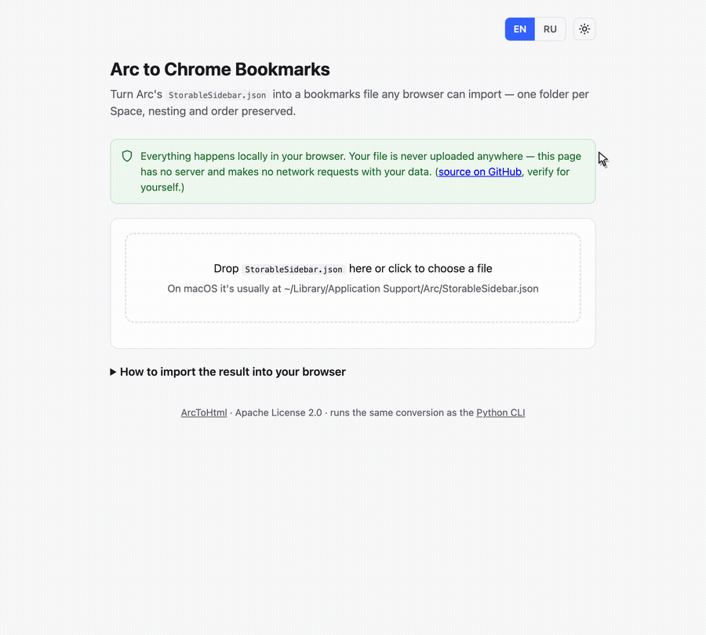

# Arc to Chrome Bookmarks

Export [Arc browser](https://arc.net/)'s sidebar (spaces, folders, pinned and
regular tabs) into a standard Netscape bookmarks HTML file that any browser —
Chrome, Firefox, Safari, Edge, Brave, etc. — can import.

Arc stores its sidebar state in a `StorableSidebar.json` file with a fairly
gnarly internal structure (alternating key/value pairs, virtual containers for
pinned tabs, parent/child relationships by ID). This tool walks that
structure and produces a clean, folder-preserving bookmarks file.

*(Читать на русском: [README.ru.md](README.ru.md))*

## Why

Arc is shutting down / you're switching browsers, and you don't want to lose
years of organized tabs and folders. Browsers don't talk to each other
directly, but they all understand the Netscape bookmarks HTML format — so
that's the bridge.

## Web version

**[Open the converter](https://MrFa1n.github.io/ArcToHtml/)** — drop in your
`StorableSidebar.json`, get `arc_bookmarks.html` back. No install, no
upload: it's a static page, the conversion runs entirely in your browser in
plain JavaScript, and your file never leaves your machine (see
[`docs/arc-converter.js`](docs/arc-converter.js) — it's a direct port of the
Python script below and produces byte-identical output).



## Usage (command line)

Requires Python 3.10+, no third-party dependencies.

1. Find `StorableSidebar.json` on your machine. On macOS it's typically under:
   ```
   ~/Library/Application Support/Arc/StorableSidebar.json
   ```
2. Run the exporter:
   ```bash
   python3 arc_to_chrome.py "/path/to/StorableSidebar.json" -o arc_bookmarks.html
   ```
   Or, if you copy `StorableSidebar.json` next to the script, just:
   ```bash
   python3 arc_to_chrome.py
   ```
3. Import `arc_bookmarks.html` into your new browser:
   - **Chrome**: `chrome://bookmarks` → ⋮ menu → *Import bookmarks*
   - **Firefox**: Bookmarks → Manage Bookmarks → Import and Backup → Import Bookmarks (HTML)
   - **Safari**: File → Import From → Bookmarks HTML File

### What gets exported

- **One top-level folder per Arc Space**, named after that Space. Since
  Chrome (and most browsers) nest an entire import under a single "Imported"
  folder, this gives you exactly as many subfolders as you have Spaces in
  Arc, instead of one giant flat pile.
- Inside each Space's folder, the original folder nesting and order are
  preserved exactly as in `StorableSidebar.json`, with every root container
  Arc keeps for that Space (there's often more than one) flattened directly
  in — no extra wrapper subfolder.
- **Arc's "Top Apps" row** (the small favicon-only tabs shown identically
  under every Space — shared rather than owned by any one of them) gets its
  own top-level folder named *"Arc — Shared Pinned"*.
- Anything that still can't be tied to a Space or a folder goes into a last
  fallback folder named *"Arc — отдельные вкладки"*, so nothing is silently
  dropped.
- Duplicate entries (same ID, or same title+URL) are skipped.

Arc's `StorableSidebar.json` doesn't always label things the way you'd
expect from the UI (e.g. a Space's container list mixes marker words like
`"pinned"`/`"unpinned"` in with real container IDs, inconsistently). To stay
robust against that, the exporter identifies each root container by its own
declared type (`data.itemContainer.containerType`) rather than trusting
those marker words.

## Sanitizing a sidebar file before sharing it

If you want to attach your `StorableSidebar.json` to a bug report, or
contribute a new sample fixture, **don't share it raw** — it contains your
real browsing history, tab titles, and internal identifiers. Use the included
helper to redact it first:

```bash
python3 tools/sanitize_arc.py StorableSidebar.json -o StorableSidebar.sanitized.json
```

This replaces URLs, titles, and anything that looks like an email address,
ID, token, or similar sensitive value with predictable placeholders, while
keeping the JSON structure intact (so it's still useful as a test fixture).
**Always double-check the output by hand before sharing it** — this is a
best-effort filter, not a guarantee.

## Project layout

```
arc_to_chrome.py        # the exporter — StorableSidebar.json -> bookmarks HTML
tools/sanitize_arc.py   # redacts a sidebar file before sharing it
docs/                    # the GitHub Pages web version (same logic, ported to JS)
examples/                # a sanitized sample StorableSidebar.json for testing
tests/                   # test suite (stdlib unittest, no dependencies)
```

## Running the tests

```bash
python3 -m unittest discover -s tests -v
```

## Contributing

See [CONTRIBUTING.md](CONTRIBUTING.md).

## License

Apache License 2.0 — see [LICENSE](LICENSE).
